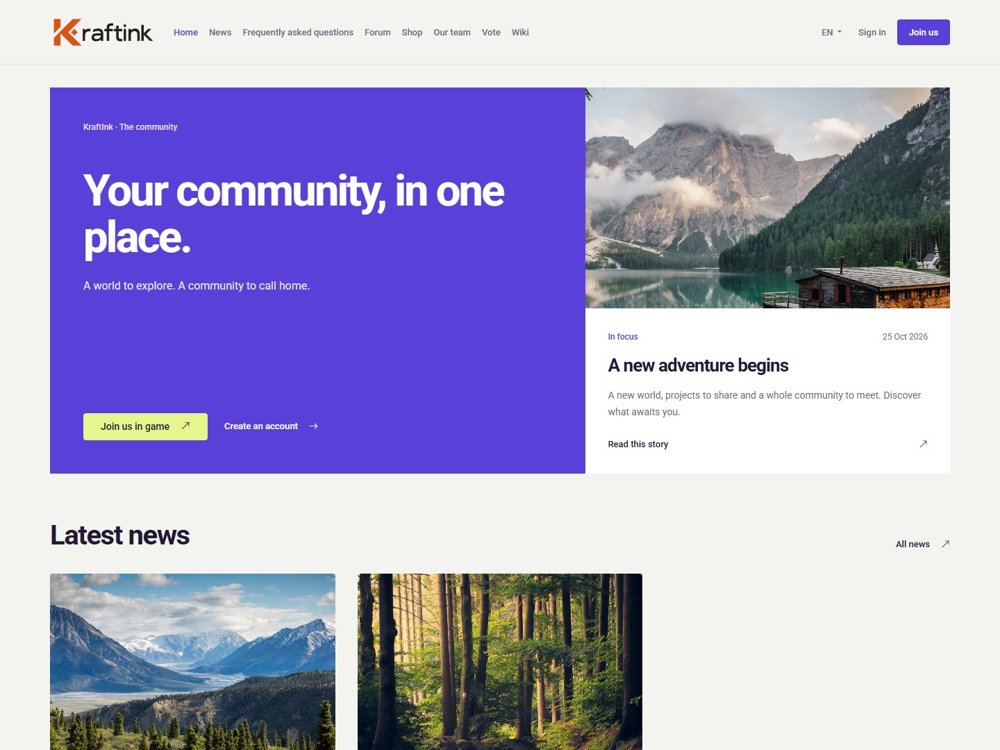

# Atelier for KraftInk

Atelier is a light theme for your KraftInk site. Its ivory and violet palette pairs large typography with an asymmetric homepage that puts a published news post in the spotlight.

## Set up Atelier

1. In KraftInk, open **Administration → Themes** and install Atelier from the catalogue or upload its ready-to-install ZIP.
2. Click **Use for website**.
3. Set your homepage heading in KraftInk and publish a news post with a cover image to fill the spotlight. Set a public server address to show visitors how to connect.

[KraftInk](https://kraftink.com/en) · [Theme installation guide](https://kraftink.com/en/documentation/extensions-catalogue) · [Discord](https://discord.kraftink.com)
